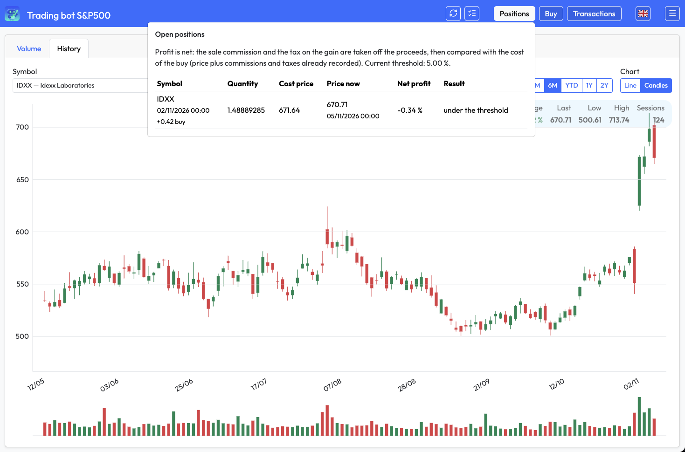
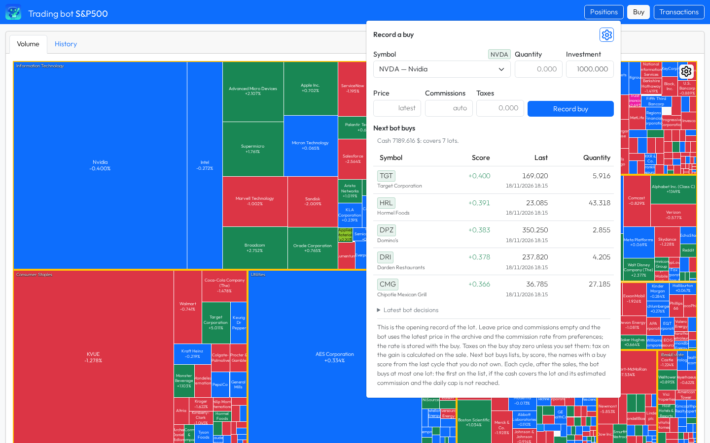
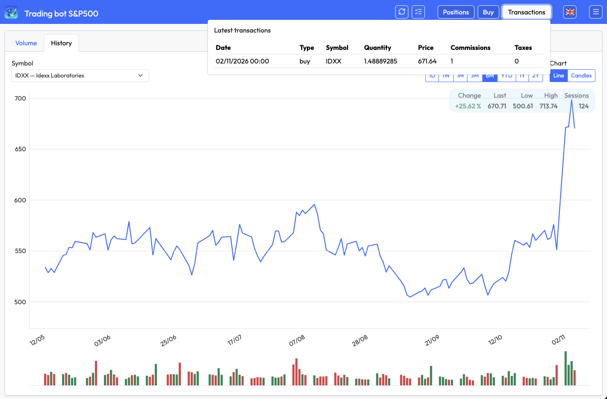
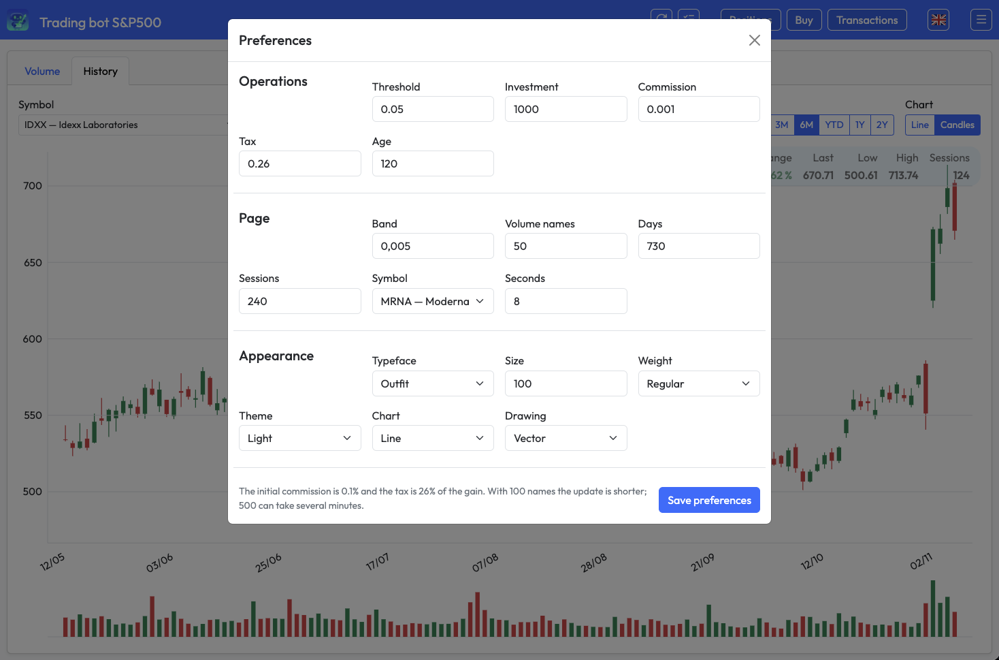

# Trading bot

Version 0.1.0.

[](https://github.com/Stecnica/trading-bot/releases/tag/v0.1.0) [](https://github.com/Stecnica/trading-bot/actions/workflows/tests.yml)

A paper-trading application for one US equity list. It stores daily prices, records buys, and records a sale when the net profit of an open lot reaches the configured threshold. Prices come from [Massive](https://massive.com/stocks). Orders are not sent to a broker: a buy or a sale is a row in the database.

The same HTTP interface is used by a person in the browser, by a scheduled run of `cycle.py`, and by a digital agent (OpenClaw or anything else that can hold a cookie and post a form). Each client has its own session. A price update takes a lock, so two updates do not write the same session twice. Other requests keep their own sessions and wait their turn on the WSGI process.

English is the default language. Every other language is a file in `lang/`.

## What you see

The page is a bar and two tabs. The icon opens the account menu. The title is the words Trading bot followed by the selected list, `S&P500`. Opening that word shows the entry and a disabled line, `next idea...`. The pictures below are the light theme.


**All** draws every name in the archive that has a price and a volume. The blocks of one sector share a gold double edge. A block’s size is the volume of the latest stored session. Its colour and the percentage on it are that session against the one before: green up, red down, blue inside the flat band. The company name sits on the block. The sector name sits on the blocks of that sector.


The gear on All opens Mode, Band, Side, Divide and Scale. This picture is Mode All, Band 0.004, Side 0, Divide On and Scale On. Divide On keeps the shorter of the two cuts between two contiguous blocks. Divide Off keeps the first cut. Scale On compresses a cell whose long side is more than 1.618 times its short side, writes that ratio on the name, and gives the empty side back to the block. The caption reads: all sectors, as blocks, 501 in the chart.


**Sector** is the other side of the same switch. This picture has the gear open: Arrangement Rank, Sessions 120, Names 240, Sector All, Group All, Band 0.004. The caption reads: among the names in the archive, the 240 with the highest return over the last 120 sessions, and 240 are in the chart. Rank places the rectangles in return order. Volume places the largest first. Sessions is how many sessions that return uses. Names is how many of those names are drawn. The sector list and the group list are the GICS names stored for this database. Choosing a sector limits the groups to that sector. The first entry of each list, All, clears that level. The tile also shows the score. The same colour rule as All. `POST /volume` saves these controls.


**History** is one symbol, as a line of daily closes or as candles, with the volume of each session underneath. Periods are built from `period.abbr.*` in the active language. One day draws the latest stored session against the session before it. Saturday and Sunday keep that pair. On a weekday the chart is empty when the newest session is older than the one the price plan should already have published. Beside the chart: change, last, low, high, and the number of sessions in the window. This picture is MRNA, the line, six months: the change is +356.62%, the last close is 241.46, the low is 43.9, the high is 261, and the window has 125 sessions. Hover reads the session date, the close, and the traded value (shares times VWAP, or times the close when VWAP is missing). The drawing is an SVG in the page by default. A generated PNG image stays in Preferences, Appearance, Drawing, as the fallback for older machines. The volume treemap stays HTML. The chart title follows the language, for example `TSLA — daily closes` or `TSLA — candles`. The same view as candles is `static/screenshot/History Candles.png`. The open sector list is `static/screenshot/Volume Sector - Sector Menu.png` and the open group list is `static/screenshot/Volume Sector - Group Menu.png`.



**Positions** lists each open lot on the same grid as Transactions: symbol, currency, quantity, buy price, latest price, net profit, and a Sell button when it is ready to sell. Under them are the buy date, the date of the latest price, the result against the threshold, and the score when there is one. A row is marked when the net profit is at or above the threshold and the price is recent enough. A lot that has reached the threshold since its buy is armed: its result reads the peak close since then and how far the latest close is under it. The net profit is the same estimate Transactions shows for the open lot. The picture predates the current layout. This picture is the open lot IDXX, bought on 02/11/2026: quantity 1.48889285 (the maximum investment of 1000 divided by the price), buy price 671.64, latest price 670.71 on 05/11/2026, net profit −0.34%, under the threshold of 5.00%.

Net profit subtracts the sale commission and the tax on the gain from the proceeds, then compares that with the cost of the buy (price plus the commissions and taxes already stored). The tax is the tax rate times the gain: sale value minus the sale commission, minus the buy value and the buy commission. A loss pays no tax. The threshold, the commission, the tax, and the maximum age of a price are preferences. Every buy and sale stores the commission rate it was charged at, and every sale also stores the tax rate and the gain it was taxed on, so a later change of the preferences does not rewrite what was recorded.



**Buy** records a lot with `POST /buy`. The fields are symbol, quantity, price, commissions, and taxes. The maximum investment sits on the same row and saves as that preference; Enter there does not record a buy. On a wide screen, quantity, investment, price, commissions and taxes are a sixth narrower than an equal share of the row. The symbol menu takes the spare width on that first row, and Record buy takes it on the second. A phone keeps two equal columns. An empty price uses the latest stored close. Empty commissions use the commission preference, and that rate is stored with the buy. Commissions typed by hand are stored with the rate they make on the amount. Empty taxes stay zero: the tax on the gain is applied when the lot is sold. The amount cannot exceed the maximum investment. Under the fields, **Next bot buys** lists the five names with the highest buy score from the last cycle that are not already owned and that a lot can buy: symbol and company, score, latest price and its moment (the session date of a daily close, or the time of the intraday price), and the quantity of one lot at that price, fractional or in whole shares as the Lot preference says. Above the list, the paper cash and how many of the bot's next buys it covers in order, commission included; with a daily cap, also today's bot buys against it. The list is the one the last cycle stored; before any cycle it says it appears after the next one. Under it, **Latest bot decisions** opens the last five cycle decisions from `bot_decisions`: time, cash before the buy, sales, the buy or the reason there was none, and the prices it read (intraday price and its time, or the close and its session); the tooltip lists the names considered and why each was passed over. In this picture the panel is open over the volume treemap. The symbol is NVDA. Quantity, price and commissions are empty, investment is 1000.000, and taxes are empty. Cash is 7189.616 and covers 7 of the next buys: TGT, HRL, DPZ, DRI and CMG.



**Transactions** has two tables on the same columns, Closed and Open lots, and a totals row under them. A closed row is one sale paired with the FIFO buy it closed: symbol, currency, quantity, buy and sell price, commissions, taxes, and the net result. Under it are the buy and sale dates, the cost and the net proceeds, the buy and sale commission each with its rate, the tax rate, and the margin in percent. An open row is a lot still held: price, cost (the notional, quantity times price, plus the buy commission), and, at the latest stored price with the current rates, the commissions (the buy paid plus the sale it would pay now), the tax and the net result a sale would give. Under it, the buy commission and the sale commission each with its rate, and the tax rate with the gain it would apply to. Those estimates are marked ≈ and do not enter Total Balance, which counts an open lot at its cost. Each table has its own sum, at two decimals, under the column it adds up: quantity, buy and sell price on a closed slice, price and cost on an open lot, the commissions and taxes that column shows, and the result in the balance column. The closed sum stays hidden until the Closed heading is clicked, and closes again with the panel. Commissions and taxes stay in their columns, so on a phone, where those columns are hidden, a sum is shown only under a column that is still there. The last row is the commissions and taxes the rows record as paid, under them what the open lots would add if sold now, and Total Balance. When the lots do not fit, the list scrolls above the totals and a chevron shows that more rows follow. Quantities and amounts show three decimals; the full quantity is the tooltip. A lot bought or sold by the cycle on a daily close carries the date of that session, without an hour; one priced on an intraday snapshot carries the moment of that price. Rows written before rates were stored carry the current preference rates, marked as estimated. A sale is the same table with type `sell`. The picture predates the current layout.

The icon’s menu holds four controls, shown open in `static/screenshot/Menu.png`. The update button is `POST /update`. It starts `cycle.py`: download missing closed sessions, then apply the sell rule. The checklist button is `POST /cycle`. It runs only the sell rule. The flag opens the language list in that same menu, shown open in `static/screenshot/Languages.png`: English, Deutsch, Español, Français, Italiano, Latina. Sign out is `POST /exit`. Preferences stay on the gear of each panel.



Preferences are three groups. Operations: threshold, At once (off by default: sell as soon as the net profit reaches the threshold, ignore the price age, and sell nothing under it), investment, commission, tax, the maximum price age, trail, keep score, maximum days, buys per day (0, the default, is no limit; at most 100), lot (fractional, the default, or whole shares), and Massive plan (Automatic, the default, or Basic, Starter, Developer, Advanced). Under the plan, a grey line shows the plan detected from the key and its feed (end of day, 15 min late, or real time); its tooltip is the time of the check. Page: flat band, how many names the volume chart keeps, history days, return sessions, the history symbol, and how long a message stays. Appearance: typeface, size, weight, theme, chart type, and drawing. Short labels sit on the fields. The full sentence is the `title` of the label and of the field. Saving one field is `POST /prefs`. A number outside its range is stored at the nearest bound, and the field shows the stored value. The menu stays open and the page does not reload. A new commission or tax applies to the transactions written after it. This picture: threshold 0.05, At once off, investment 1000, commission 0.001, tax 0.26, price age 120 hours, flat band 0.005, 50 volume names, 730 history days, 240 return sessions, history symbol MRNA, messages stay 8 seconds, typeface Outfit, size 100, weight regular, theme Light, chart Line, drawing Vector.

Theme **Automatic** follows the browser’s local time: light from 07:00 to 19:00, dark otherwise. Light and Dark stay fixed. The first paint uses the server clock; the page then follows the browser.

A message slides out under the bar when an update starts and when it finishes. It does not appear on an ordinary page load. While an update is running the page refreshes every 20 seconds. `?preview=messages` holds the message open and cycles four styles, for checking text, border, fill, and opacity.

## Operators

A person uses the buttons. An agent uses the same routes as the form. OpenClaw is one such agent: it signs in, holds the cookie, and posts.

A schedule runs `python cycle.py` on weekdays. The reference crontab runs it every 30 minutes from 15:00 to 21:30 and once more at 22:15, server time, after the US cash session has closed. The process needs the database variables and `MASSIVE_API_KEY`, the same ones the application uses; the crontab reads them from `private/bot.env`. The hours belong in the reader's own crontab. What a run reads depends on the Massive plan of the key, described under Prices: with Stocks Basic every run of a day reads the same last close; with a paid plan each run during the session reads that moment's price. One run does three things, in this order.

It downloads the closed sessions that are not in the archive yet. A session is published after it has closed, so that hour is when the new daily bars arrive. When the plan includes intraday prices and the New York session is open, it then reads one snapshot of the whole market and stores each name's latest price as today's provisional bar.

It applies the trailing sale to every open lot whose latest price is recent enough. With At once on, the price age is ignored and the only sale is a net profit already at the threshold; under the threshold that run sells nothing, neither on the trail, nor on the score, nor after the maximum days. Net profit is the one described under Positions: the sale commission and the tax on the gain come off the proceeds, then the result is compared with the cost of the buy. A lot is armed at the first close since its buy that brings the net profit to the threshold. An armed lot is kept while its score is at least the keep score (0.2) and the latest close is less than the trail (3%) under the highest close since arming. During the session the latest close is the provisional bar, so the peak includes the prices the runs have read today only while each is the newest; the peak of a day is fixed by its published close. It is sold when the score falls under the keep score, when the close is the trail or more under that peak, or when the net profit falls back to the threshold. These sales never happen at a loss: an armed lot whose net profit is under zero is kept. A trail of 0 sells at the first close over the threshold, as before. The sale row stores the commission rate, the tax rate, and the taxed gain.

It then reads the score. An open lot whose score side is sell is sold only when its net profit is at or above the threshold; below it the lot is kept. A lot held longer than the maximum days (120) is sold at the latest close whatever the result. After the sales, the run records at most one buy, whether or not lots are open. It walks the ranking from the highest score and takes the first name whose side is buy, that is not held and was not sold in this run, and whose lot the paper cash covers. A lot is the maximum investment (1000) divided by the latest close: fractional to eight decimals by default, or whole shares when the Lot preference says so; in whole shares a name priced above the lot buys zero and is passed over. The cash is the paper Balance after this run's sales: the starting capital, minus every buy (notional, commission and taxes), plus every sale (notional minus commission and taxes). The lot is bought only when that cash is at least the notional plus the estimated commission (notional times the commission rate). With a cap on buys per day, no buy is made once the cycle has written that many today; buys recorded by hand do not count. The walk stops at the first score at or under zero. On Basic the runs of a day read the same close, so each run can add one more lot at that close until the cash or the cap runs out; with intraday prices each lot is priced at the price of its run. Every run writes one row in `bot_decisions`: the time, the cash before the buy, the sales, the names considered with the reason each was skipped (not buy, held, sold in this run, priced above the lot, not enough cash), the buy or the reason there was none (no cash, daily cap, no candidate), and the source and moment of the prices it read. The run also stores the first buy scores for **Next bot buys**. The buy and the sale are rows in `transactions`.

`POST /update` starts that same command. `POST /cycle` runs only the trailing sale.

## Continuing

Two connections carry the same cycle out to a run that decides and orders on its own. The first is the Massive plan on the key, which sets how far back and how live the bars are. The second is a broker API on the write of a buy or a sale. After both, a crontab calls `python cycle.py` at the hours you choose, or an OpenClaw instance studies the stored sessions and the preferences and posts the decision. The orders then leave for the account.

The preferences that decision reads are the threshold, the commission, the tax, the maximum investment, the lot sizing, the buys per day, the trail, the keep score, the maximum days, and the score.

**The price plan.** `deploy/prepare.py` writes `private/massive_api.env`. Set `MASSIVE_API_KEY` there to a key of the plan you are exercising. Names, windows, and prices of the plans are in the table under Prices.

| Plan | What the cycle asks for |
| --- | --- |
| Stocks Basic | The session after the close, two years back. |
| Stocks Starter | The session delayed fifteen minutes, five years, unlimited calls, WebSocket, and flat files. |
| Stocks Developer | The same fifteen-minute session, ten years back. |
| Stocks Advanced | The live session, and daily history back to 10 September 2003. |
| Stocks Business | The live session and that history, under a commercial licence, with proprietary exchange feeds added. |

`update_from_massive` in `bot_massive.py` calls `get_grouped_daily_aggs`. `last_completed_session` treats 16:00 New York as the close and returns the last weekday whose close has passed. From that day, `_pending` walks back `HISTORY_DAYS` (731), the Basic window, on every plan. The intraday session is already read for Starter, Developer and Advanced (`update_live`, under Prices). What is left for a paid key is the longer history: lengthen the walk to five or ten years for Starter or Developer, or start it at 2003-09-10 for Advanced or Business; without the throttle a missing session is one call. Where the plan includes flat files, add that reader beside `update_from_massive` and keep its coordinates in `private/massive_api.env`.

Run `python cycle.py`. The bars land in `market_history`, and the threshold sale and the score follow them. The period buttons post `1`, `7`, `30`, `90`, `180`, `ytd`, `365`, and `730`. Add the five-year, ten-year, and full-archive values once those bars are in the table.

**The broker.** `POST /buy`, `sell_ready_lots`, and `bot_decide.apply_once` finish in `insert_transaction`. Add the broker call on that write. The same symbol, quantity, price, and side go to the broker API, and the row is stored when the broker accepts the order. Keep the credentials in `private/`, beside the Massive key, outside the repository.

Point the call at the broker's paper account. It is the same API with a separate endpoint and simulated money, so the whole path can be tested. Run `python cycle.py`, or sign OpenClaw in and post `/update`. The paper account shows the order, and `transactions` shows the matching row. The funded account is that same call on the live endpoint.

With a live session from Advanced or Business, and with the broker accepting the write, the crontab and OpenClaw act on the preferences: the threshold, the commission, the tax, the maximum investment, the lot sizing, the buys per day, the trail, the keep score, the maximum days, and the score.

Sign in with `POST /login` (`username`, `password`, `csrf`). `bot` can change the book. `leonardobot` can open the pages and nothing else: buys, sales, preferences, the volume controls, the update, the sell rule and the history fill are refused. Each password is one scrypt line in `private/`, `ui_password` for `bot` and `ui_password_leonardobot` for the view account. A clear copy of the view password is `private/leonardobot.password`. The first successful check replaces a clear password line with its hash. Sign-ins and those operations are appended to `private/access.log`. The session cookie lasts about a year and is refreshed on each request. Sign out is `POST /exit`. Five failed attempts lock the application for 15 minutes.

Every POST carries the `csrf` value from the page. After sign-in the routes are:

| Route | Role |
| --- | --- |
| `POST /buy` | Record a buy. Fields: `asset`, `amount`, `price`, `fees`, `taxes`, `csrf`. The commission rate is stored with the row. |
| `POST /sell` | Record one paper sale for an open lot. Fields: `lot` (buy transaction id), `csrf`. Refuses a missing or stale price. Uses the same `quote_sell` path as automatic sales. |
| `POST /cycle` | Apply the sell rule to lots that are ready. |
| `POST /update` | Start one price update, which then applies the sell rule. |
| `POST /prefs` | Save preferences. Field names match the inputs in the dialog. A number out of range is clamped to its bound; unreadable text answers `ok: false` with the error. |
| `POST /volume` | Save the volume picture: `return_days` (1–240), `names` (10–500, step 10), `volume_class`, `stable_band` (0–0.2), `min_side` (0–2), `order` (`rank` or `volume`), `scope` (`all` or `sector`), `divide` and `scale` (`off` or `on`), `csrf`. |
| `POST /exit` | End this session. |

`volume_class` is empty for the whole archive, `s:` plus a sector name, or `u:` plus a sector, a pipe, and a group name.

Two agents can be signed in at the same time. They do not share a session. The price update is the exception: `cycle.lock` admits one update. A second start is told that an update is already running.

## Languages

Each valid JSON file in `lang/` is one language, and the language menu lists it. A file that does not parse, or whose name is not a language code, is left out. The file name is the code, for example `en.json`. `language.name` in the file is the name shown beside the flag, written in that language. The default is English. The application does not follow `Accept-Language`. `?lang=` followed by a code that has a file selects it and stores the `lang` cookie for one year. The sign-in card keeps its own flag at the top right. Status written by a running update is a catalog key, so the same status file is shown in the language of the reader. An older status that is already a sentence is shown as stored.

Period buttons are built from five abbreviations in the active language file: `period.abbr.day`, `period.abbr.week`, `period.abbr.month`, `period.abbr.year`, and `period.abbr.start`. The buttons are one day, one week, one month, three months, six months, the start-of-year abbreviation, one year, and two years. The values posted with the chart stay `1`, `7`, `30`, `90`, `180`, `ytd`, `365`, `730`.

## Prices

The client is the official `massive` package. One call is the grouped daily aggregate for the US stock market:

`GET /v2/aggs/grouped/locale/us/market/stocks/{date}`

The call asks for unadjusted bars and does not ask for OTC, so the OTC flag stays null. Each stored bar keeps the symbol, the session date, open, high, low, close, volume, VWAP, trade count, and the bar timestamp in milliseconds.

A session the plan refuses as outside its history window is not requested again.

**The plan of the key.** The run finds out what the key can do; nobody has to say it. Once a New York day it asks Massive for the snapshot of one name (`GET /v2/snapshot/locale/us/markets/stocks/tickers/AAPL`):

- refused as not entitled (403, `NOT_AUTHORIZED`), or answered with 429, too many calls: **Basic**;
- answered during the session with a price older than five minutes: delayed. One more call asks for a daily bar from six years ago: refused is **Starter** (five years), served is **Developer** (ten);
- answered during the session with a price under five minutes old: **Advanced**, real time.

Outside the session the age of the price says nothing, so a paid key checked then is taken as delayed and checked again at the first run of the session. The result goes to `private/massive_plan.json` and into the log once, when it is checked. A check that cannot reach Massive is tried again an hour later; meanwhile the run behaves as Basic.

| Plan | What a run does |
| --- | --- |
| Basic | End of day only. Missing sessions are fetched one every 13 seconds, under the cap of five calls a minute. No intraday call is made. |
| Starter, Developer | Missing sessions without a pause. From 9:30 to 16:15 New York, one snapshot of the whole market per run: prices 15 minutes late. |
| Advanced | The same, real time, from 9:30 to 16:00. |

The preference **Massive plan** in Operations overrides the detection: Automatic (the default) follows it, a named plan is used as it is. When the intraday snapshot is refused, whatever the preference says, the runs go back to end of day until the next New York day, the refusal is logged once, and the plan is checked again. Any other failure of that call, or a snapshot with fewer than 400 of the names priced in today's session (a holiday), leaves the daily bars in place for that run. The run does not stop for any of them.

What a new user with a free key sees: the plan line under the preference reads Basic, end of day. Each weekday the first run after the close brings the new session; the other runs of the day read the same close, as the scheduled hours above describe. Nothing fails and the log shows no intraday errors.

The snapshot is `GET /v2/snapshot/locale/us/markets/stocks/tickers`, one call for the market. For each listed name whose last update falls in today's regular session it stores a bar dated at today's session, like a daily bar: the day's running close as price, the day's open, high, low, volume and VWAP, the moment of the update in `bar_ms`, and `live = 1`. The next run overwrites it. When the session is published the daily bar replaces it, and a provisional bar the daily file does not contain is deleted. The sale checks, the score and the price of a buy or a sale read the provisional bar like a close, and the transaction carries the moment of that price. The LightGBM part of the score predicts from it, as if the session closed at that price, but never trains on it: `bot_slow.train` reads only bars with `live = 0`.

Plan windows, read from Massive on 1 November 2026. Check the sources before relying on a price or a window. The history window is counted back from the request, not from a fixed start date.

| Plan | Price | Bars | Calls | Delivery |
| --- | --- | --- | --- | --- |
| Stocks Basic | Free | 2 years, end of day | 5 per minute | REST |
| Stocks Starter | $29 per month | 5 years, 15-minute delayed | Unlimited on paid plans | REST, WebSocket, flat files |
| Stocks Developer | $79 per month | 10 years, 15-minute delayed | Unlimited on paid plans | REST, WebSocket, flat files |
| Stocks Advanced | See the pricing page | All history back to 2003-09-10, real time | Unlimited on paid plans | REST, WebSocket, flat files |
| Stocks Business | $2,499 per month | All history, commercial licence | Unlimited on paid plans | REST, WebSocket, flat files |

Sources:

- [Massive stocks](https://massive.com/stocks), including the plan cards and the note that paid plans are listed with unlimited API calls
- [Pricing](https://massive.com/pricing)
- [How much historical stock data does Massive have?](https://massive.com/knowledge-base/article/how-much-historical-stock-data-does-massive-have) — Basic 2 years of bars, Starter 5, Developer 10, Advanced and Business everything back to 10 September 2003. Basic has no flat files. The pricing page’s “20+ years” is that same archive.

Individual plans are licensed for personal, non-professional use. Display or redistribution needs Business.

**Filling the history.** The daily archive can reach as far back as the plan serves bars: Basic 2 years, Starter 5, Developer 10, Advanced and Business back to 10 September 2003. `python backfill.py` fills it, one grouped daily call per missing session, newest first:

```
python backfill.py --dry-run      # missing sessions, estimated bars, megabytes and minutes, free disk
python backfill.py                # fill for the plan in use (detected, or the Massive plan preference)
python backfill.py --plan basic   # the depth of another plan
python backfill.py --limit 50     # at most 50 sessions
```

A session already fetched, a known closed day, or a day that holds 480 names is skipped, so the command can be stopped at any point and started again: it continues from the next missing session. One fill runs at a time (`private/backfill.lock`). It writes each session under `private/prices.lock`, which `cycle.py` holds for its whole run, so a fill and a cycle never write together: the fill waits for the cycle, and a cycle waits for at most one session write. On Basic it waits 13 seconds between calls, so two years (about 500 sessions) take about two hours; on the paid plans it does not wait. A refusal as outside the plan's window ends the fill there. It stops with a reason, and resumes on the next start, when the disk under the database has less than 300 MB free, on a call refused for another reason, or on a day with too few tickers to be a full session. Progress is in `private/backfill_status.json` and in the log.

The same job starts from Operations: under the preferences, a grey line gives the oldest stored session and, when the plan reaches further, a **Fill to** link with the date it would reach. While it runs the line shows the session being fetched and the count, refreshed every 15 seconds; afterwards it says whether the history is complete or why the fill stopped. The request only starts `backfill.py` in the background.

Sizes, measured on this archive: about 300 bytes per bar with its indexes, about 470 bars per session. Five years add about 760 sessions (360,000 bars, 100 MB) and take about half an hour on Starter. Ten years add about 280 MB, the full archive about 740 MB; run `--dry-run` first. The score reads only the last 120 calendar days, the Volume chart its own window and a history chart one name, so a deeper archive does not slow the cycle or the page. Older sessions keep only the names of today's list that were trading then. Bars are not adjusted for splits, as in the rest of the archive.

The history buttons stop at two years. Longer ranges are not offered yet, even when the stored bars cover them. Flat files are not downloaded. The key file can hold extra lines for a later S3 setup; the application reads only `MASSIVE_API_KEY`.

The selected list is the S&P 500. A session stores every name on that list that the response contains. The volume chart then keeps the strongest trailing returns inside the chosen sector or group. The ranking reads only the sessions it needs, not the whole archive.

## Database

Six tables. `deploy/schema.sql` creates them. On startup `ensure_schema` creates any that are missing, adds missing price columns and `live` to an older `market_history`, the two price columns to an older `bot_decisions`, and missing rate columns to an older `transactions`, and fills the rates of rows that have none with the current preferences, marked `estimated`. Running it again changes nothing. It does not drop indexes that a live database already has.

| Table | Contents |
| --- | --- |
| `preferences` | One row per setting: name and value. |
| `market_history` | One bar per symbol and session. `live` is 1 for today's provisional bar from the intraday snapshot, with the moment of its price in `bar_ms`, and 0 for a published daily bar. |
| `transactions` | Buys and sales. `type` is `buy` or `sell`. Symbol, quantity, price, `timestamp` (the session the price belongs to, a bar date being midnight; or the moment of an intraday price), commissions and taxes as amounts, `currency`, `fee_rate`, `tax_rate` and `taxable_gain` (sales only), `rates_source` (`recorded` when written, `estimated` when filled later), and `recorded_at`, the moment of the write. |
| `classification` | GICS sector and group. A sector has no parent. A group points at its sector. |
| `asset_class` | Symbol to its group. The symbol is the same `asset_name` used by prices and transactions. |
| `bot_decisions` | One row per cycle: `created_at`, `cash_before`, `action` (`buy` or `none`), `reason` (`bought`, `no_cash`, `daily_cap`, `no_candidate`), the symbol, quantity, price and cost of the buy, the symbols `sold` in that cycle, and `candidates`, a JSON list of the names considered with score, side, price and the reason each was skipped (at most 30, then a count), `price_source` (`live` for the intraday snapshot, `close` for a daily bar) and `price_at`, the moment of the bought name's price, else of the newest price the ranking read. |

## Start

Requirements: Python 3.10 and MariaDB on the machine. From the repository:

```
pip install -r requirements.txt
python deploy/prepare.py
```

That command creates the directory `private` beside the repository, writes the three files below, creates the database `trading` through the local MariaDB root socket, loads six invented sessions, and serves http://127.0.0.1:8000 . Sign in as `bot` with the password the command prints. `--no-serve` stops before the page, for a machine that already serves `app.wsgi`.

`private/ui_password` is one line, the password just printed.

`private/database.env`

```
DB_SERVER=localhost
DB_USERNAME=trading
DB_PASSWORD=9f3c1a0e7b24
DB_NAME=trading
```

The password is generated. The same value is the MariaDB user `trading`. Without this file the application reads the same variables from `private/bot.env`, the file the crontab sources. The values in `private/` win over any `DB_*` already in the process environment, so a stale value in the web server configuration does not shadow them; the database credentials do not belong in `.htaccess` or in the server configuration.

`private/massive_api.env`

```
MASSIVE_API_KEY=paste-the-key-here
```

Replace that placeholder with a key from Massive when you want a real price update. The sample page opens without it. The first sign-in replaces the password line with a scrypt hash. Do not commit `private/`.

## Beyond the two connections

`TODO.md` carries the next list, a loss limit, the exchange holiday calendar, and the reconciliation of quantities with the account.

## Contributing

[CONTRIBUTING.md](CONTRIBUTING.md) is how to add a language, carry a price plan through, or connect a broker.

## Licence

[MIT](LICENSE). Copyright (c) 2026 Stefano Monti (Stecnica), <https://www.itecnica.it>.
