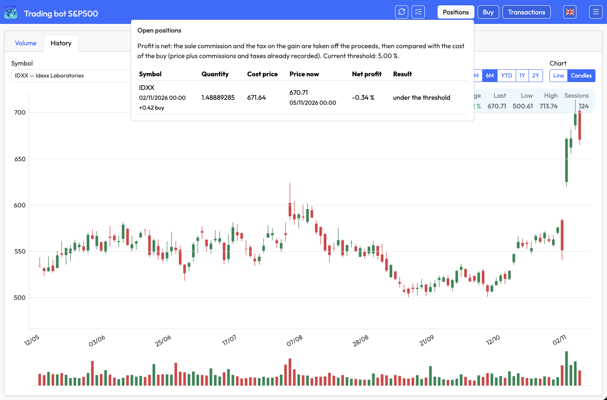
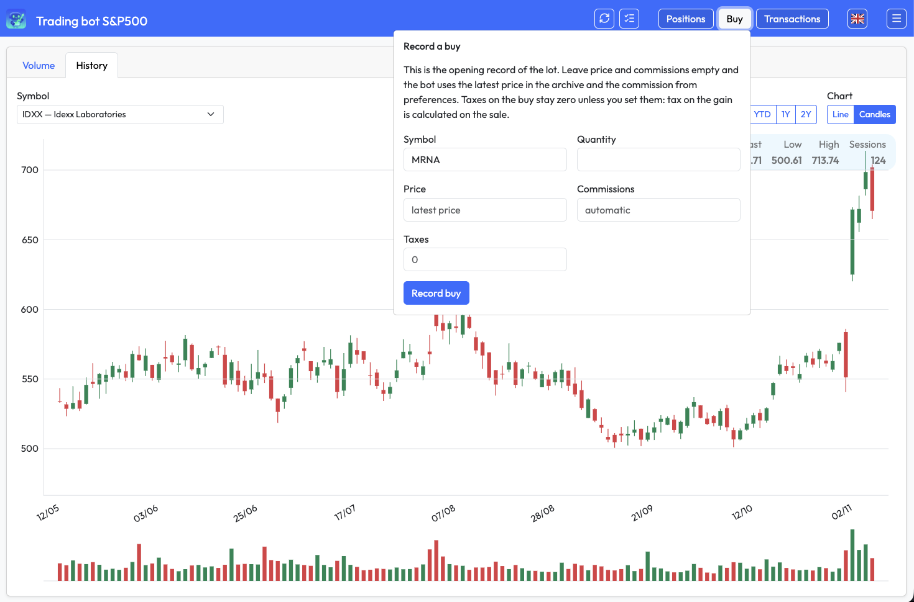
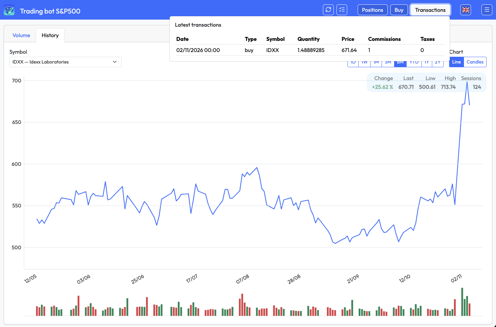
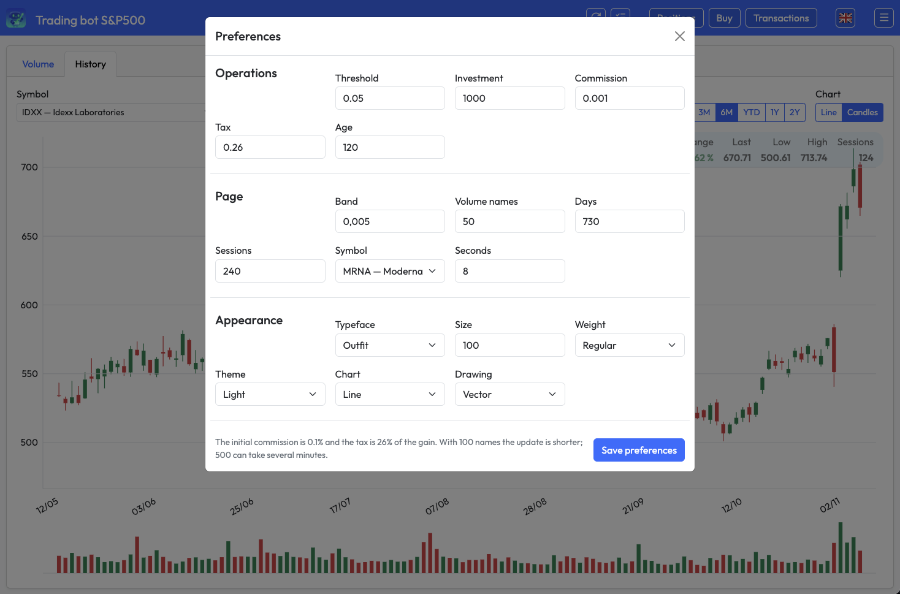

# Trading bot

Version 0.1.0.

A paper-trading application for one US equity list. It stores daily prices, records buys, and records a sale when the net profit of an open lot reaches the configured threshold. Prices come from [Massive](https://massive.com/stocks). Orders are not sent to a broker: a buy or a sale is a row in the database.

The same HTTP interface is used by a person in the browser, by a scheduled run of `cycle.py`, and by a digital agent (OpenClaw or anything else that can hold a cookie and post a form). Each client has its own session. A price update takes a lock, so two updates do not write the same session twice. Other requests keep their own sessions and wait their turn on the WSGI process.

English is the default language. Every other language is a file in `lang/`.

## What you see

The page is a bar and two tabs. The icon links home. The title is the words Trading bot followed by the selected list, `S&P500`. Opening that word shows the entry and a disabled line, `next idea...`. The pictures below are the light theme.


**All** draws every name in the archive that has a price and a volume. The blocks of one sector share a gold double edge. A block’s size is the volume of the latest stored session. Its colour and the percentage on it are that session against the one before: green up, red down, blue inside the flat band. The company name sits on the block. The sector name sits on the blocks of that sector.


The gear on All opens Mode, Band, Side, Divide and Scale. This picture is Mode All, Band 0.004, Side 0, Divide On and Scale On. Divide On keeps the shorter of the two cuts between two contiguous blocks. Divide Off keeps the first cut. Scale On compresses a cell whose long side is more than 1.618 times its short side, writes that ratio on the name, and gives the empty side back to the block. The caption reads: all sectors, as blocks, 501 in the chart.


**Sector** is the other side of the same switch. This picture has the gear open: Arrangement Rank, Sessions 120, Names 240, Sector All, Group All, Band 0.004. The caption reads: among the names in the archive, the 240 with the highest return over the last 120 sessions, and 240 are in the chart. Rank places the rectangles in return order. Volume places the largest first. Sessions is how many sessions that return uses. Names is how many of those names are drawn. The sector list and the group list are the GICS names stored for this database. Choosing a sector limits the groups to that sector. The first entry of each list, All, clears that level. The tile also shows the score. The same colour rule as All. `POST /volume` saves these controls.


**History** is one symbol, as a line of daily closes or as candles, with the volume of each session underneath. Periods are built from `period.abbr.*` in the active language. Beside the chart: change, last, low, high, and the number of sessions in the window. This picture is MRNA, the line, six months: the change is +356.62%, the last close is 241.46, the low is 43.9, the high is 261, and the window has 125 sessions. Hover reads the session date, the close, and the traded value (shares times VWAP, or times the close when VWAP is missing). The drawing is either a generated image or an SVG in the page. The volume treemap stays HTML. The chart title follows the language, for example `TSLA — daily closes` or `TSLA — candles`. The same view as candles is `static/screenshot/History Candles.png`. The open sector list is `static/screenshot/Volume Sector - Sector Menu.png` and the open group list is `static/screenshot/Volume Sector - Group Menu.png`.



**Positions** lists each open lot, its cost, the latest price, the net profit, and whether it is ready to sell. A row is marked when the net profit is at or above the threshold and the price is recent enough. This picture is the open lot IDXX, bought on 02/11/2026: quantity 1.48889285, cost 671.64, latest price 670.71 on 05/11/2026, net profit −0.34%, under the threshold of 5.00%.

Net profit subtracts the sale commission and the tax on the gain from the proceeds, then compares that with the cost of the buy (price plus the commissions and taxes already stored). The threshold, the commission, the tax, and the maximum age of a price are preferences.



**Buy** records a lot with `POST /buy`. The fields are symbol, quantity, price, commissions, and taxes. An empty price uses the latest stored close. Empty commissions use the preference. Empty taxes stay zero: the tax on the gain is applied when the lot is sold. The amount cannot exceed the maximum investment. In this picture the panel is open over the IDXX candle chart. The symbol field contains MRNA. Quantity, price, and commissions are empty, and taxes are 0.



**Transactions** lists the latest buys and sales. A sale is the same table with type `sell`. This picture is the one stored buy, over the IDXX line: 02/11/2026, IDXX, quantity 1.48889285, price 671.64, commissions 1, taxes 0.

The update button is `POST /update`. It starts `cycle.py`: download missing closed sessions, then apply the sell rule. The checklist button is `POST /cycle`. It runs only the sell rule. **Preferences** and **Sign out** are in the main menu, shown open in `static/screenshot/Menu.png`. The language menu is the flag button just before it, shown open in `static/screenshot/Languages.png`: English, Español, Français, Italiano, Latina.



Preferences are three groups. Operations: threshold, investment, commission, tax, and the maximum price age. Page: flat band, how many names the volume chart keeps, history days, return sessions, the history symbol, and how long a message stays. Appearance: typeface, size, weight, theme, chart type, and drawing. Short labels sit on the fields. The full sentence is the `title` of the label and of the field. Saving one field is `POST /prefs`. The menu stays open and the page does not reload. This picture: threshold 0.05, investment 1000, commission 0.001, tax 0.26, price age 120 hours, flat band 0.005, 50 volume names, 730 history days, 240 return sessions, history symbol MRNA, messages stay 8 seconds, typeface Outfit, size 100, weight regular, theme Light, chart Line, drawing Vector.

Theme **Automatic** follows the browser’s local time: light from 07:00 to 19:00, dark otherwise. Light and Dark stay fixed. The first paint uses the server clock; the page then follows the browser.

A message slides out under the bar when an update starts and when it finishes. It does not appear on an ordinary page load. While an update is running the page refreshes every 20 seconds. `?preview=messages` holds the message open and cycles four styles, for checking text, border, fill, and opacity.

## Operators

A person uses the buttons. An agent uses the same routes as the form. OpenClaw is one such agent: it signs in, holds the cookie, and posts.

A schedule runs `python cycle.py` once, on weekdays, after the US cash session has closed. The process needs the database variables and `MASSIVE_API_KEY`, the same ones the application uses. The hour belongs in the reader's own crontab. One run does three things, in this order.

It downloads the closed sessions that are not in the archive yet. On Stocks Basic a session is published after it has closed, so that hour is when the new bars arrive.

It sells every open lot whose net profit is at or above the threshold, when the latest price is recent enough. Net profit is the one described under Positions: the sale commission and the tax on the gain come off the proceeds, then the result is compared with the cost of the buy.

It then reads the score. An open lot whose score side is sell is sold. If no lot is open after that, the run records at most one buy: the name with the highest buy score, within the maximum investment. While a lot stays open, it waits. The buy and the sale are rows in `transactions`.

`POST /update` starts that same command. `POST /cycle` runs only the threshold sale.

## Continuing

Two connections carry the same cycle out to a run that decides and orders on its own. The first is the Massive plan on the key, which sets how far back and how live the bars are. The second is a broker API on the write of a buy or a sale. After both, a crontab calls `python cycle.py` at the hours you choose, or an OpenClaw instance studies the stored sessions and the preferences and posts the decision. The orders then leave for the account.

The preferences that decision reads are the threshold, the commission, the tax, the maximum investment, and the score.

**The price plan.** `deploy/prepare.py` writes `private/massive_api.env`. Set `MASSIVE_API_KEY` there to a key of the plan you are exercising. Names, windows, and prices of the plans are in the table under Prices.

| Plan | What the cycle asks for |
| --- | --- |
| Stocks Basic | The session after the close, two years back. |
| Stocks Starter | The session delayed fifteen minutes, five years, unlimited calls, WebSocket, and flat files. |
| Stocks Developer | The same fifteen-minute session, ten years back. |
| Stocks Advanced | The live session, and daily history back to 10 September 2003. |
| Stocks Business | The live session and that history, under a commercial licence, with proprietary exchange feeds added. |

`update_from_massive` in `bot_massive.py` calls `get_grouped_daily_aggs`. `last_completed_session` treats 16:00 New York as the close and returns the last weekday whose close has passed. From that day, `_pending` walks back `HISTORY_DAYS` (731). For a Basic key, leave that window: the new bars arrive after the close, and the weekday run meets them. For a Starter or Developer key, include the delayed session the plan is publishing, and lengthen the walk to five or ten years. For an Advanced or Business key, include the live session and start the walk at 2003-09-10. Where the plan includes flat files, add that reader beside `update_from_massive` and keep its coordinates in `private/massive_api.env`.

Run `python cycle.py`. The bars land in `market_history`, and the threshold sale and the score follow them. The period buttons post `1`, `7`, `30`, `90`, `180`, `ytd`, `365`, and `730`. Add the five-year, ten-year, and full-archive values once those bars are in the table.

**The broker.** `POST /buy`, `sell_ready_lots`, and `bot_decide.apply_once` finish in `insert_transaction`. Add the broker call on that write. The same symbol, quantity, price, and side go to the broker API, and the row is stored when the broker accepts the order. Keep the credentials in `private/`, beside the Massive key, outside the repository.

Point the call at the broker's paper account. It is the same API with a separate endpoint and simulated money, so the whole path can be tested. Run `python cycle.py`, or sign OpenClaw in and post `/update`. The paper account shows the order, and `transactions` shows the matching row. The funded account is that same call on the live endpoint.

With a live session from Advanced or Business, and with the broker accepting the write, the crontab and OpenClaw act on the preferences: the threshold, the commission, the tax, the maximum investment, and the score.

Sign in with `POST /login` (`username`, `password`, `csrf`). The username is `bot`. The password is the single line in `private/ui_password`. The first successful check replaces that line with a scrypt hash. The session cookie lasts about a year and is refreshed on each request. Sign out is `POST /exit`. Five failed attempts lock the application for 15 minutes.

Every POST carries the `csrf` value from the page. After sign-in the routes are:

| Route | Role |
| --- | --- |
| `POST /buy` | Record a buy. Fields: `asset`, `amount`, `price`, `fees`, `taxes`, `csrf`. |
| `POST /cycle` | Apply the sell rule to lots that are ready. |
| `POST /update` | Start one price update, which then applies the sell rule. |
| `POST /prefs` | Save preferences. Field names match the inputs in the dialog. |
| `POST /volume` | Save the volume picture: `return_days` (1–240), `names` (10–500, step 10), `volume_class`, `stable_band` (0–0.2), `min_side` (0–2), `order` (`rank` or `volume`), `scope` (`all` or `sector`), `divide` and `scale` (`off` or `on`), `csrf`. |
| `POST /exit` | End this session. |

`volume_class` is empty for the whole archive, `s:` plus a sector name, or `u:` plus a sector, a pipe, and a group name.

Two agents can be signed in at the same time. They do not share a session. The price update is the exception: `cycle.lock` admits one update. A second start is told that an update is already running.

## Languages

Each valid JSON file in `lang/` is one language, and the language menu lists it. A file that does not parse, or whose name is not a language code, is left out. The file name is the code, for example `en.json`. `language.name` in the file is the name shown beside the flag, written in that language. The default is English. The application does not follow `Accept-Language`. `?lang=` followed by a code that has a file selects it and stores the `lang` cookie for one year. The same menu is the flag at the top right of the sign-in card. Status written by a running update is a catalog key, so the same status file is shown in the language of the reader. An older status that is already a sentence is shown as stored.

Period buttons are built from five abbreviations in the active language file: `period.abbr.day`, `period.abbr.week`, `period.abbr.month`, `period.abbr.year`, and `period.abbr.start`. The buttons are one day, one week, one month, three months, six months, the start-of-year abbreviation, one year, and two years. The values posted with the chart stay `1`, `7`, `30`, `90`, `180`, `ytd`, `365`, `730`.

## Prices

The client is the official `massive` package. One call is the grouped daily aggregate for the US stock market:

`GET /v2/aggs/grouped/locale/us/market/stocks/{date}`

The call asks for unadjusted bars and does not ask for OTC, so the OTC flag stays null. Each stored bar keeps the symbol, the session date, open, high, low, close, volume, VWAP, trade count, and the bar timestamp in milliseconds.

This copy is written for Stocks Basic. On that plan a session that is still open is not requested. A session the plan refuses as outside its history window is not requested again. Five calls per minute is the Basic cap, so the update waits between sessions. Paid plans remove that cap. The code does not switch plans by itself: it uses the key it is given.

Plan windows, read from Massive on 1 November 2026. Check the sources before relying on a price or a window. The history window is counted back from the request, not from a fixed start date.

| Plan | Price | Bars | Calls | Delivery |
| --- | --- | --- | --- | --- |
| Stocks Basic | Free | 2 years, end of day | 5 per minute | REST |
| Stocks Starter | $29 per month | 5 years, 15-minute delayed | Unlimited on paid plans | REST, WebSocket, flat files |
| Stocks Developer | $79 per month | 10 years, 15-minute delayed | Unlimited on paid plans | REST, WebSocket, flat files |
| Stocks Advanced | See the pricing page | All history back to 2003-09-10, real time | Unlimited on paid plans | REST, WebSocket, flat files |
| Stocks Business | $2,499 per month | All history, commercial licence | Unlimited on paid plans | REST, WebSocket, flat files |

Sources:

- [Massive stocks](https://massive.com/stocks), including the plan cards and the note that paid plans are listed with unlimited API calls
- [Pricing](https://massive.com/pricing)
- [How much historical stock data does Massive have?](https://massive.com/knowledge-base/article/how-much-historical-stock-data-does-massive-have) — Basic 2 years of bars, Starter 5, Developer 10, Advanced and Business everything back to 10 September 2003. Basic has no flat files. The pricing page’s “20+ years” is that same archive.

Individual plans are licensed for personal, non-professional use. Display or redistribution needs Business.

The history buttons stop at two years, which is the Basic window. Longer ranges are not offered until the stored bars cover them. Flat files are not downloaded. The key file can hold extra lines for a later S3 setup; the application reads only `MASSIVE_API_KEY`.

The selected list is the S&P 500. A session stores every name on that list that the response contains. The volume chart then keeps the strongest trailing returns inside the chosen sector or group. The ranking reads only the sessions it needs, not the whole archive.

## Database

Five tables. `deploy/schema.sql` creates them. On startup `ensure_schema` creates any that are missing and adds missing price columns to an older `market_history`. It does not drop indexes that a live database already has.

| Table | Contents |
| --- | --- |
| `preferences` | One row per setting: name and value. |
| `market_history` | One bar per symbol and session. |
| `transactions` | Buys and sales. `type` is `buy` or `sell`. |
| `classification` | GICS sector and group. A sector has no parent. A group points at its sector. |
| `asset_class` | Symbol to its group. The symbol is the same `asset_name` used by prices and transactions. |

## Start

Requirements: Python 3.10 and MariaDB on the machine. From the repository:

```
pip install -r requirements.txt
python deploy/prepare.py
```

That command creates the directory `private` beside the repository, writes the three files below, creates the database `trading` through the local MariaDB root socket, loads six invented sessions, and serves http://127.0.0.1:8000 . Sign in as `bot` with the password the command prints. `--no-serve` stops before the page, for a machine that already serves `app.wsgi`.

`private/ui_password` is one line, the password just printed.

`private/database.env`

```
DB_SERVER=localhost
DB_USERNAME=trading
DB_PASSWORD=9f3c1a0e7b24
DB_NAME=trading
```

The password is generated. The same value is the MariaDB user `trading`.

`private/massive_api.env`

```
MASSIVE_API_KEY=paste-the-key-here
```

Replace that placeholder with a key from Massive when you want a real price update. The sample page opens without it. The first sign-in replaces the password line with a scrypt hash. Do not commit `private/`.

## Beyond the two connections

`TODO.md` carries the next list, a loss limit, the exchange holiday calendar, and the reconciliation of quantities with the account.

## Licence

[MIT](LICENSE). Copyright (c) 2026 Stefano Monti (Stecnica), <https://www.itecnica.it>.
